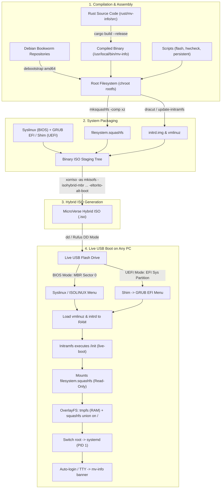

# MicroVerse OS: From Source Code to Bootable Live Hybrid ISO

**Author:** MicroVerse OS Engineering Team  
**Architecture:** x86_64 (amd64)  
**Target Base:** Debian 12 (Bookworm)  
**Primary Artifact:** `microverse-final.iso`  

---

## 1. Architectural Overview & Pipeline Diagram

The journey from source code and Debian package repositories to a self-contained, live USB-bootable operating system is divided into two distinct lifecycle phases:

1. **The Build Pipeline (Host Side):** Compiling source code, bootstrapping the root filesystem, installing kernel and drivers, compressing into SquashFS, generating bootloader configurations, and packaging via `xorriso` into an isohybrid ISO.
2. **The Execution Pipeline (Target PC Side):** Hardware firmware (UEFI / BIOS) discovery, MBR/GPT handoff, bootloader execution, kernel decompression, initramfs hardware enumeration, SquashFS loop mounting, overlayfs union mounting, and systemd initialization.



---

## 2. Step-by-Step Technical Deep Dive

### Phase 1: Source Code Compilation (Rust Tool `mv-info`)
The custom telemetry utility `mv-info` is written in pure Rust without external dynamic dependencies.
- **Source Directory:** `rust/mv-info/`
- **Build Command:**
  ```bash
  cargo build --release --manifest-path rust/mv-info/Cargo.toml
  strip rust/mv-info/target/release/mv-info
  ```
- **Staging:** The resulting 300 KB ELF 64-bit binary is installed directly into `/usr/local/bin/mv-info` within the target chroot.

### Phase 2: Debootstrap & Chroot Construction
Debootstrap downloads, unpacks, and configures the core Debian 12 packages into an isolated root directory:
```bash
debootstrap --arch=amd64 bookworm /path/to/chroot http://deb.debian.org/debian/
```
Within the chroot environment:
1. The official generic kernel is installed: `apt-get install -y linux-image-amd64 live-boot live-config live-config-systemd`.
2. Broad initramfs driver support is configured in `/etc/initramfs-tools/conf.d/modules.conf` using `MODULES=most`.
3. Systemd, bash, network management, wireless firmware, and hardware tools are provisioned according to stage requirements.
4. Auto-login and user permissions are established (`microverse` user, `live` password, NOPASSWD sudo).

### Phase 3: SquashFS Compression
The entire chroot filesystem is compressed into a single read-only compressed SquashFS image:
```bash
mksquashfs /path/to/chroot filesystem.squashfs -comp xz -Xbcj x86 -b 1048576 -noappend
```
- **Compression Ratio:** Typically reduces a 2.5 GB root directory down to ~450–700 MB.
- **XZ Filter:** The `-Xbcj x86` bytecode filter optimizes x86_64 executable instructions for enhanced compression density.

### Phase 4: Bootloader Preparation (Dual BIOS & UEFI)
To boot on both modern UEFI machines and legacy BIOS machines, two separate bootloaders are staged:
1. **Syslinux / ISOLINUX (Legacy BIOS):**
   - Files: `isolinux.bin`, `ldlinux.c32`, `vesamenu.c32`, `live.cfg.in`.
   - Reads the MBR boot sector and displays a graphical/textual boot menu.
2. **GRUB EFI + Microsoft-Signed Shim (UEFI with Secure Boot):**
   - Files: `EFI/BOOT/BOOTX64.EFI` (Shim signed by Microsoft 3rd Party UEFI CA), `EFI/BOOT/grubx64.efi` (GRUB signed by Debian Secure Boot CA), and `boot/grub/efi.img` (FAT16 image holding EFI binaries).
   - Reads the EFI System Partition (ESP) without requiring Secure Boot to be disabled.

### Phase 5: Isohybrid Master Generation (`xorriso`)
The hybrid ISO combines an ISO9660 filesystem, a DOS MBR partition table, an El Torito BIOS boot catalog, and an EFI System Partition:
```bash
xorriso -as mkisofs \
    -iso-level 3 \
    -full-iso9660-filenames \
    -volid "MICROVERSE" \
    -isohybrid-mbr /usr/lib/ISOLINUX/isohdpfx.bin \
    -eltorito-boot isolinux/isolinux.bin \
    -eltorito-catalog isolinux/boot.cat \
    -no-emul-boot -boot-load-size 4 -boot-info-table \
    -isohybrid-gpt-basdat \
    -eltorito-alt-boot \
    -e boot/grub/efi.img \
    -no-emul-boot \
    -isohybrid-gpt-basdat \
    -output ./out/microverse-final.iso \
    ./binary_staging/
```

---

## 3. How a Live USB Boots on Another Computer

When the flashed USB is plugged into any third-party laptop or desktop, the target machine undergoes the following sequence:

```
+-------------------------------------------------------------------------+
| [1] MOTHERBOARD FIRMWARE INITIALIZATION (Power-On Reset)               |
|  - UEFI Mode: Firmware reads GPT / MBR partition table.                 |
|    Finds FAT partition (Type 0xEF), executes \EFI\BOOT\BOOTX64.EFI.    |
|  - BIOS Mode: BIOS reads Sector 0 (MBR 512 bytes).                      |
|    Executes ISOHYBRID boot code -> transfers control to isolinux.bin.  |
+-------------------------------------------------------------------------+
                                    |
                                    v
+-------------------------------------------------------------------------+
| [2] BOOTLOADER MENU DISPLAY & SELECTION                                 |
|  - Displays menu: Live (default), Safe Graphics, Toram, Persistence.    |
|  - Loads selected kernel (/live/vmlinuz) and initrd (/live/initrd.img). |
|  - Passes kernel command line: boot=live components quiet splash ...    |
+-------------------------------------------------------------------------+
                                    |
                                    v
+-------------------------------------------------------------------------+
| [3] KERNEL & INITRAMFS HARDWARE ENUMERATION                             |
|  - Kernel uncompresses, discovers CPU, APIC, ACPI, PCI devices.         |
|  - Initramfs /init script runs (/usr/share/initramfs-tools/scripts/live)|
|  - Scans all block devices (USB, NVMe, SATA) for live media label.     |
+-------------------------------------------------------------------------+
                                    |
                                    v
+-------------------------------------------------------------------------+
| [4] ROOT FILESYSTEM OVERLAY CREATION                                    |
|  - Mounts /live/medium/live/filesystem.squashfs on /run/live/rootfs/sfs.|
|  - Creates an overlayfs union:                                          |
|      Upper directory: tmpfs (RAM) or persistence partition (/ union)    |
|      Lower directory: read-only squashfs                                |
|  - Merges into single transparent root: /run/live/overlay -> /root      |
+-------------------------------------------------------------------------+
                                    |
                                    v
+-------------------------------------------------------------------------+
| [5] ROOT PIVOT & SYSTEMD PID 1 EXECUTION                                |
|  - Executes run-init / pivot_root to transition into new root.          |
|  - Launches /sbin/init (systemd PID 1).                                 |
|  - Starts udev, systemd-journald, NetworkManager, and login getty.      |
|  - Automatically logs in 'microverse' user and triggers mv-info banner. |
+-------------------------------------------------------------------------+
```

---

## 4. Key Performance Insights

- **Zero-Disk Footprint:** The host PC's internal NVMe or SATA hard drives are NEVER touched or modified. All temporary writes live exclusively in RAM (`tmpfs`), unless the user explicitly enables persistence.
- **Portability:** The combination of `MODULES=most`, generic `linux-image-amd64`, signed Microsoft Shim, and Syslinux hybrid MBR ensures out-of-the-box compatibility across Intel, AMD, Dell, HP, Lenovo, ASUS, and Acer platforms.
